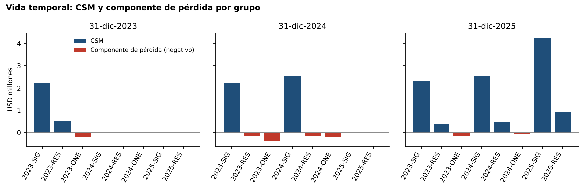
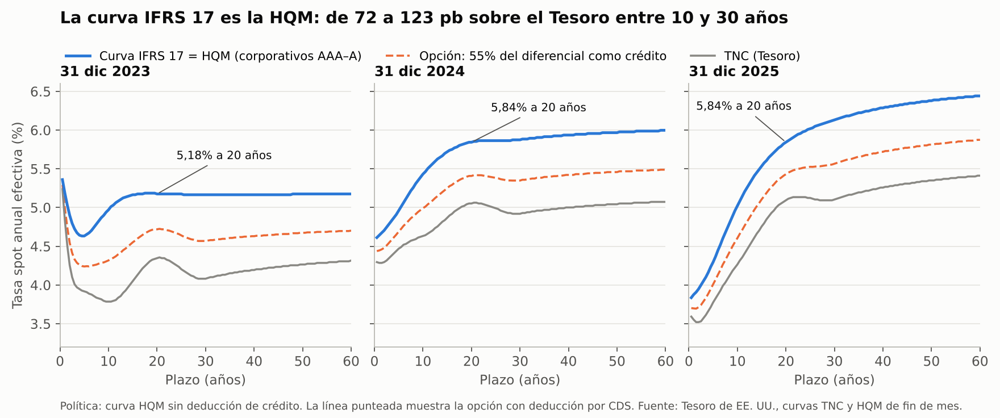

# IFRS 17 end-to-end: Seguros Barú, S.A.

Portfolio project by **Heydi** ([@Heydnz](https://github.com/Heydnz)). It applies IFRS 17 *Insurance Contracts*, as issued by the IASB, to a **fictional** Panamanian insurer with general and life business, from contract grouping to financial statements and disclosures. Every decision is justified with the paragraph of the standard that supports it.

> Seguros Barú is fictional. All data are synthetic and reproducible (fixed seed), calibrated only with public sources. No client data or assumptions are used.

## Scope

| Portfolio | Coverage | Model | What it shows |
|---|---|---|---|
| Motor | 1 year | PAA (53(b)) | LRC under PAA, LIC with case reserves and Bornhuetter-Ferguson IBNR on CAS patterns, discounted (59(b)), PAA onerous test (57-58) |
| Fire / home | 1 year | PAA | Acquisition costs expensed (59(a)), undiscounted LIC (59(b)) |
| Contractors' all risk | 3 years | PAA eligibility test (53(a), 54) | PAA vs GMM comparison decides the model |
| Term life | 10-20 years | GMM | CSM, coverage units (B119), three profitability groups, onerous group at inception |
| Savings life | long term | GMM | Investment component, investment-return service (B119B), why not VFA (B101) |
| Quota share held on term life | - | GMM (60-70A) | Reinsurance CSM, loss-recovery component (66A-66B) |

Valuation dates: 31 Dec 2023, 2024 and 2025 (the company starts on 1 Jan 2023, so there is no transition). Statements follow IAS 1; a pro-forma IFRS 18 view of profit or loss is added for every year (memo Annex A).

## Status

| Phase | Content | Status |
|---|---|---|
| 0 | Design and accounting policy memo (Spanish) | Done, in review |
| 1 | Discount curves, mortality (CSO 1980), CAS claims patterns, synthetic portfolio and experience | Done |
| 2 | Grouping by profitability (par. 14-24), PAA onerous indicator, CAR eligibility test (53(a), 54) | Done |
| 3 | GMM engine validated with the IASB Illustrative Examples; term life measured at three closings | Done |
| 4 | PAA LRC, onerous test (57-58), LIC with case reserves + Bornhuetter-Ferguson IBNR, 75th-percentile RA | Done |
| 5 | Savings life with investment component (par. 85, B96(c)) and quota share held with loss-recovery component | Done |
| 6 | Statements, reconciliations and disclosures (par. 100-132), Excel workbook with live formulas | Done |
| 7 | Narrative notebooks, dashboard, publication | In progress |

95 automated tests pass (`pytest`; the full-portfolio ones are marked `slow`).

## Results at a glance

| USD | 2023 | 2024 | 2025 |
|---|---:|---:|---:|
| Insurance revenue | 9,780,724 | 21,995,636 | 26,742,566 |
| Insurance service result (net of reinsurance) | 450,534 | 1,888,113 | 2,551,051 |
| Net financial result | 1,362,466 | 1,372,778 | 1,993,241 |
| Profit before tax | 593,623 | 2,015,122 | 3,249,198 |
| Total equity at 31 Dec | 20,593,043 | 21,445,639 | 25,580,091 |

Assets less liabilities equal equity at every closing (difference 0.00), and the 92 control cells of the Excel workbook are zero: every opening balance is the previous closing balance, every roll-forward adds up to the closing balance the engine measured.



The scripted story of memo section 12 comes out of the engine, not out of hard-coded numbers:

* **2023**: the promotional channel of term life is onerous at recognition (VT-2023-ONE, loss USD 163,680); 40% of it is recognised as income by the quota share (66A, B119D). Commercial fleets fall in the "remaining" motor group.
* **2024**: the reinsurer's mortality study for older lives with high sums insured moves the best estimate from 75% to 115% of CSO 1980. The CSM of VT-2023-RES and VT-2024-RES runs out and both groups become onerous (par. 48). Spare-parts inflation makes the 2024 fleet group onerous under the PAA test (57-58).
* **2025**: the new study (85%) reverses the losses first and then rebuilds the CSM (par. 50(b)); the quota share reverses its recoveries (66(c)(ii)). The 2025 fleet cohort is onerous from the start (par. 18); contractors' all risk passes the PAA eligibility test for every cohort, with a maximum difference of 4.6% against the GMM.

## Dashboard

`docs/index.html` is a static dashboard (GitHub Pages: publish the `docs/` folder) with the statements, the CSM cascade by portfolio and year, every group with its profitability class, revenue by portfolio, the expected CSM release (par. 109), the sensitivities (par. 128) and the CAR eligibility test. `scripts/build_dashboard.py` rebuilds it from `data/results/`.

## Notebooks (Spanish)

| Notebook | Content |
|---|---|
| `01_curva_de_descuento` | TNC + HQM curves, credit-share option, Smith-Wilson cross-check |
| `02_datos_sinteticos` | Synthetic portfolio, CSO 1980, mortality study, CAS patterns |
| `03_agregacion_y_modelo` | Profitability groups, PAA onerous indicator, CAR eligibility test, why savings life is not VFA |
| `04_motor_gmm` | GMM engine on the IASB examples, term life at three closings |
| `05_paa_y_lic` | PAA LRC, onerous test, LIC with hindsight check, claims development |
| `06_vida_ahorro_y_reaseguro` | Investment component, crediting commitment (B98), loss-recovery component |
| `07_cierres_y_revelaciones` | Statements, reconciliations, par. 106-132 disclosures, IFRS 18 view |

## Validation against the IASB Illustrative Examples

`tests/test_gmm_iasb_examples.py` runs the GMM engine on the inputs of IFRS 17 Illustrative Examples 1 (initial recognition), 2A and 2B (subsequent measurement, group becoming onerous), 7 (acquisition cash flows), 8 (reversal of losses and the systematic allocation to the loss component) and 12C (loss-recovery component of reinsurance held), and checks the published figures. One difference is documented: Example 8 recognises the CSM created by a year-end reversal only in the following year, whereas the engine allocates the CSM at the end of the period across current and future coverage units (par. 44(e), B119), as in Example 2A.

## Discount curves (Phase 1)

Bottom-up approach (IFRS 17 B79-B80):

1. **Base curve:** US Treasury Nominal Coupon-issue (TNC) end-of-month spot rates, 0.5 to 100 years every half year, semiannual compounding (the Treasury holds the forward rate constant beyond 30 years).
2. **Illiquidity premium by maturity:** High Quality Market (HQM, AAA-A corporates) end-of-month spot rate minus TNC.
3. **Chosen policy:** the full spread is added, so the discount curve is the HQM curve (TNC + (HQM - TNC) = HQM). This is an accounting judgement: the spread also compensates credit risk, so the sensitivity to deducting it is disclosed.
4. **Options kept in the engine:** deduct a credit share (reference 55%, from the CDS evidence of Longstaff, Mithal and Neis, 2005, weighted by rating, floored by the expected loss; see `illiquidity.py`) and grade the premium by liability liquidity (100/75/50%).
5. **Monthly curve:** converted to annual effective rates and interpolated to monthly maturities (1-1,200 months), log-linear in discount factors.

`src/ifrs17/treasury_curves.py` implements it and `scripts/build_discount_curves.py` builds it from the Treasury workbooks in `data/raw/treasury/` (`tnceom_23_27.xlsx`, `hqmeom_19_23.xls`, `hqmeom_24_28.xls`).

| 20-year spot rate, annual effective | 31 Dec 2023 | 31 Dec 2024 | 31 Dec 2025 |
|---|---|---|---|
| TNC (Treasury) | 4.35% | 5.05% | 5.09% |
| **IFRS 17 curve = HQM (policy)** | **5.18%** | **5.84%** | **5.84%** |
| Option: 55% of the spread deducted as credit | 4.72% | 5.41% | 5.43% |

A Smith-Wilson curve fitted to the daily Treasury par yields (`src/ifrs17/curves.py`) is kept as an independent cross-check: it stays within 13 bp of the TNC curve up to 30 years at the three closings.



## Repository layout

```
src/ifrs17/
  treasury_curves.py, illiquidity.py, discounting.py, curves.py   discount curves (memo s8)
  mortality.py, experience.py, assumptions.py                     non-financial assumptions (s9)
  simulate.py, data.py                                            synthetic portfolio and "as known at" reader
  life.py, risk_adjustment.py                                     term-life projection, pricing, cost-of-capital RA
  gmm.py                                                          GMM engine for one group and one period
  term_life.py, savings.py, reinsurance.py                        GMM portfolios
  pc.py                                                           PAA portfolios, LIC, CAR eligibility test
  closing.py, disclosures.py                                      statements and par. 100-132 disclosures
tests/               pytest suite, including the IASB Illustrative Examples
scripts/             data, closings, Excel and figures
data/raw/            public inputs, with their source
data/processed/      curves and claims patterns
data/synthetic/      simulated administrative data (policies, premiums, claims, payments, case reserves, expenses)
data/results/        statements and disclosures (CSV) and the dashboard data
excel/               reconciliation workbooks with live formulas
docs/                accounting policy memo (Spanish) and figures
notebooks/           narrative notebooks (Spanish)
```

## How to run

```bash
pip install -e ".[dev]"
python scripts/build_discount_curves.py      # curves (options: --credit-share 0.55, --graded-liquidity)
python scripts/build_claims_patterns.py      # CAS patterns (needs: pip install chainladder)
python scripts/run_simulation.py             # synthetic data, fixed seed
python scripts/run_closings.py               # measurement, statements and disclosures (about 2 minutes)
python scripts/export_results_excel.py       # excel/Cierres_IFRS17_Seguros_Baru.xlsx
python scripts/plot_results.py
pytest                                       # or: pytest -m "not slow"
```

## Data sources

| Data | Source | Licence |
|---|---|---|
| TNC spot rates, end of month | [US Treasury, Office of Economic Policy](https://home.treasury.gov/data/treasury-coupon-issues-and-corporate-bond-yield-curves/treasury-coupon-issues) | US government work, public domain |
| HQM spot rates, end of month | [US Treasury, Office of Economic Policy](https://home.treasury.gov/data/treasury-coupon-issues-and-corporate-bond-yield-curve/corporate-bond-yield-curve) | US government work, public domain |
| Treasury par yield curve (cross-check) | [US Department of the Treasury](https://home.treasury.gov/resource-center/data-chart-center/interest-rates/TextView?type=daily_treasury_yield_curve) | US government work, public domain |
| UFR (cross-check only) | [EIOPA](https://www.eiopa.europa.eu/eiopa-publishes-ultimate-forward-rate-ufr-2025-2024-03-27_en) | Public methodology |
| 1980 CSO mortality, ANB (tables 42 and 36) | [Society of Actuaries, mort.soa.org](https://mort.soa.org/) | Public table |
| Loss Reserving Database (Schedule P, 1988-1997) | [Casualty Actuarial Society](https://www.casact.org/publications-research/research/research-resources/loss-reserving-data-pulled-naic-schedule-p), via the `chainladder` package | Public research data |
| IFRS 17 Illustrative Examples (test inputs) | [IFRS Foundation](https://www.ifrs.org/) | Figures cited for validation only |

The daily par-yield snapshot (cross-check only) was captured from the Treasury website on 2026-10-02; `scripts/download_treasury.py` re-downloads the official CSV files and reports any difference.

## License

Code under the [MIT licence](LICENSE). The memo, figures and notebook text under [CC BY 4.0](LICENSE-docs.md). Public data sources keep their own terms (see `LICENSE-docs.md`).
